

  

  

 

  

  

 

  

  

 

  

  

 

  

  

 

  

  <picture>
    <source media="(prefers-color-scheme: dark)" srcset="./profile-3d-contrib/profile-night-rainbow.svg" />
    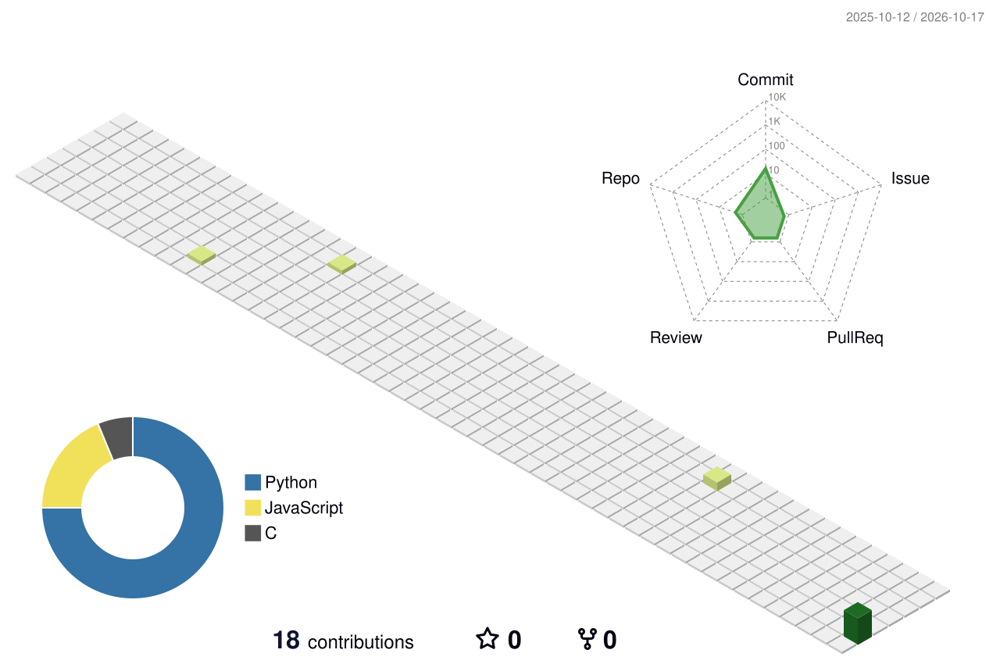
  </picture>

 

  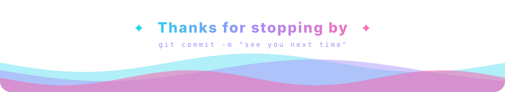

  

